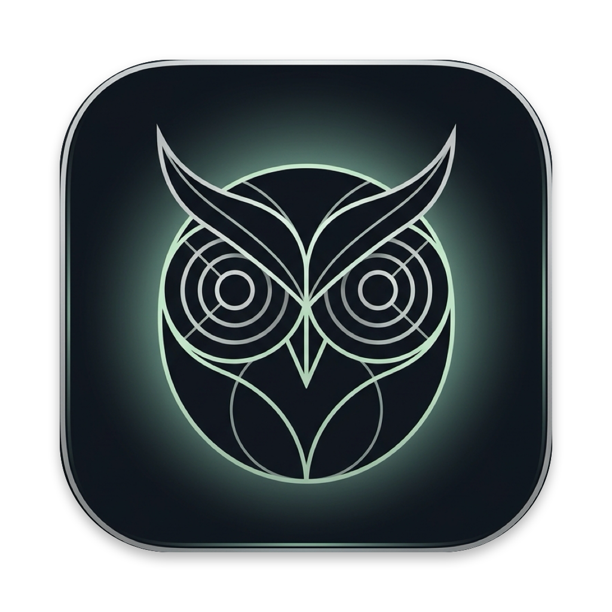

<p align="center">
  
</p>

<h1 align="center">Otus (鸺鹠)</h1>

<p align="center">
  <strong>1:1 复刻 Alma 核心架构的超轻量 macOS 后台静默记录与晚间个人折腾日记生成器</strong><br>
  <em>剥离臃肿宿主 · 纯粹原汁原味 · 零外部 NPM 依赖 · 单进程常驻</em>
</p>

---

## 🌟 为什么做 Otus？

Alma 是一款非常出色的桌面 AI 伴侣，其最打动人心的功能莫过于：**白天后台无感静默记录动态，晚间自动生成一份详实的第一人称“个人折腾日记”与 GitHub 绿阶心流矩阵**。

但在日常使用中，官方客户端捆绑了繁重的 Electron 渲染框架、聊天界面、长驻子进程与高耗电。**Otus 的目标是：彻底剥离其臃肿的宿主外壳，100% 忠实复刻 Alma 原生验证可行的底层记录与总结链路，跑出一个干净、极简、无负担的基线版本。**

---

## 🏗️ 核心架构与 1:1 对标

| 核心组件 | 对标 Alma 实现 | Otus 原生实现细节 |
| :--- | :--- | :--- |
| **持久化存储** | SQLite 5 表关系模型 | `activity_sessions` / `snapshots` / `ocr_frames` / `events` / `summaries`，基于 Node 26 原生 `node:sqlite`，**0 外部依赖** |
| **事件感知** | `alma-input-monitor` | 原生 Swift 编译二进制，通过 Cocoa Global Monitor 捕获按键停顿、点击、应用焦点切换与锁屏 |
| **屏幕捕获与 OCR** | `alma-ocr` | 原生 `screencapture -x -C` 静音抓拍 + 图像哈希判重 + Apple Vision 框架精准离线 OCR |
| **浏览器穿透** | `alma-browser-tab` | 原生常驻 AppleScript 进程，毫秒级读取 Chrome、Safari 等活跃标签 URL 与页面标题 |
| **微会话分析** | `ActivityAnalyzer` | 异步状态机会话切分，采用 Alma 原版 Prompt 提取 Project、Topics、Highlights 与结构化 Entities（PR/Issue/Commit） |
| **日终报告引擎** | `ActivitySummarizer` | **零 Token 本地 Jaccard 聚类算法**（相似度 $\ge 0.18$）生成结构化 Markdown 骨架 + 严苛防幻觉 Hard Rules 润色 |
| **心流热力图** | `template.html` | 完整复刻 07:00–22:00（15×12=180 格）GitHub 绿阶心流矩阵、小时专注雷达与任务占比图 |
| **磁盘生命周期** | `ActivityRotator` | 自动轮转管理快照存储，定期释放过期大图，元数据永久归档 SQLite |

---

## 🚀 快速上手

### 环境要求
- macOS 13+ (Apple Silicon / Intel)
- Node.js >= 22 (推荐 Node 26，内置 `node:sqlite` 与 `--experimental-strip-types`)

### 基础命令

```bash
# 1. 查看当前守护进程状态与今日统计
./bin/otus status

# 2. 单次测试当前屏幕抓拍与 Apple Vision OCR
./bin/otus test-capture

# 3. 运行未分析会话的微小结处理
./bin/otus analyze

# 4. 实时查看今日个人折腾日记（终端 Markdown 渲染）
./bin/otus report

# 5. 导出并自动在浏览器中打开今日 180 槽位 GitHub 绿阶心流报告
./bin/otus export
```

---

## ⚙️ 后台常驻与自启 (launchd)

通过 macOS 原生 `launchd` 进行守护，重启自动拉起，崩溃自动恢复，无任何前台窗口干扰：

```bash
# 一键安装为后台静默守护服务
./scripts/install.sh

# 查看服务运行状态
./bin/otus status

# 卸载后台服务
./scripts/uninstall.sh
```

---

## 🔑 LLM 配置（可选）

Otus 具备完善的离线启发式分析兜底（未配置任何 API 亦可 100% 正常抓拍、OCR 与输出本地结构化骨架）。

如需启用大模型深度总结与第一人称润色，可在终端或环境变量中配置兼容 OpenAI 的接口：

```bash
export OTUS_LLM_URL="https://api.openai.com/v1"   # 或本地 Magpie / Ollama 网关
export OTUS_LLM_KEY="your-api-key"
export OTUS_ANALYSIS_MODEL="deepseek-chat"        # 白天微会话小结模型
export OTUS_REPORT_MODEL="deepseek-chat"          # 晚间日记润色模型
```

---

## 📄 License
MIT © David Lin
